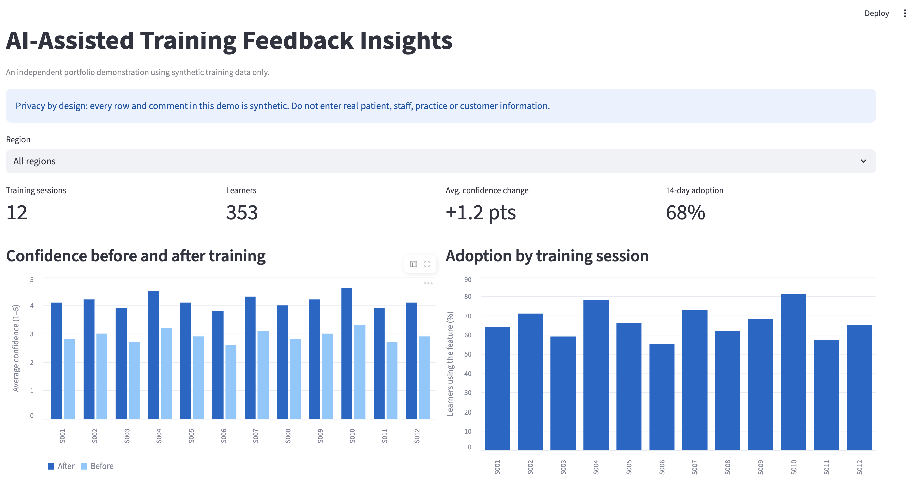

# AI-Assisted Training Feedback Insights

An independent portfolio project that combines a small training-adoption dashboard with optional AI-assisted feedback analysis. It demonstrates how implementation teams could review training signals, identify follow-up needs and turn user feedback into practical improvements.

> **Privacy and scope:** This project uses fictional, synthetic data only. It is not an NHS or Accurx product and is not affiliated with either organisation. It does not measure real-world NHS or clinical outcomes.

## What the project does

- Summarises training sessions, learner attendance, completion, confidence change and 14-day feature adoption.
- Shows session-level confidence and adoption charts in a Streamlit dashboard.
- Optionally sends aggregate metrics and synthetic comments to an OpenAI model for concise themes, improvement ideas and a limitation.
- Keeps the API key outside the source code, in a local environment variable.

## Dataset

`data/synthetic_training_feedback.csv` contains 12 fictional training sessions across Scotland, Wales and Northern Ireland. Every practice-like label, metric and feedback comment is invented for demonstration. Confidence uses a 1–5 scale. Adoption is a fictional percentage measured 14 days after a session.

## Demo results

The dashboard summarises 12 fictional training sessions and 353 fictional learners.

- Average confidence change: +1.2 points on a 1–5 scale
- Weighted 14-day feature adoption: 68.5%

These results are calculated from fully synthetic data and do not represent real NHS users or product impact.



## Run locally

1. Install Python 3.10 or newer.
2. Open a terminal in this project folder.
3. Create and activate a virtual environment.
4. Install dependencies:

   ```bash
   pip install -r requirements.txt
   ```

5. Start the dashboard:

   ```bash
   streamlit run app.py
   ```

The dashboard and metrics work without an API key. To enable live AI analysis, set `OPENAI_API_KEY` as an environment variable in your local terminal, then restart Streamlit. You can optionally set `OPENAI_MODEL`; the default is `gpt-5-mini`.

Example for macOS/Linux:

```bash
export OPENAI_API_KEY="your_key_here"
streamlit run app.py
```

Example for Windows PowerShell:

```powershell
$env:OPENAI_API_KEY="your_key_here"
streamlit run app.py
```

Do not paste an API key into `app.py`, `.env.example`, screenshots, or a public repository. If you use a local `.env` file, keep it untracked; `.gitignore` excludes it.

## AI workflow

1. The dashboard calculates weighted completion, confidence change and adoption from the selected synthetic sessions.
2. When requested, the app sends these aggregates and the synthetic feedback comments to the selected model.
3. The prompt asks for evidence-based observations, low-risk training improvements and one limitation.
4. A person should review any AI-generated suggestions before using them. The model output is not a clinical recommendation.

## Limitations

- The dataset is small and fully invented; the results do not show actual product adoption or training impact.
- The project does not establish causation between training and later feature use.
- AI-generated observations can be incomplete or wrong and require human review.
- API use may incur charges under the account's current pricing and settings.
